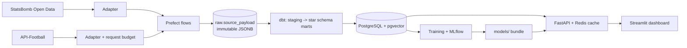

# Football Analytics Platform

End-to-end football analytics: ingest public match data, model it in a warehouse, serve it through
an authenticated API, explore it in a dashboard and estimate match outcomes with a validated model.

> Built as a portfolio project to practise backend, data engineering and applied ML in one codebase.
> Data: [StatsBomb Open Data](https://github.com/statsbomb/open-data) (see [Attribution](#data-attribution)).

## Architecture



| Layer | Choice | Why |
|---|---|---|
| Raw | one insert-only table, content-hashed JSONB, DB trigger blocks UPDATE/DELETE | re-runs are no-ops, upstream corrections become new versions, nothing is lost |
| Transform | dbt: `staging` (typed views/tables) -> `marts` (star schema) | tested, documented SQL; the API never reads raw JSON |
| Keys | surrogate `hash(source, natural_id)` | swapping or adding a data provider does not rewrite facts |
| API | FastAPI, API-key auth, parameterised SQL, Redis cache that fails open | cache outage degrades latency, not availability |
| DB access | API connects as `api_reader`: SELECT on `marts` only, read-only transactions, 5 s timeout | a bug or injection in the API cannot write or reach raw data |
| ML | scikit-learn, walk-forward validation, MLflow tracking | honest evaluation on small data |

## Data model

- Dimensions: `dim_team`, `dim_player`, `dim_competition`, `dim_season`, `dim_date`
- Facts: `fact_match`, `fact_event`, `fact_shot` (with StatsBomb xG), `fact_lineup`
- Marts: `mart_team_form` (rolling form over the previous 5 matches, no look-ahead),
  `mart_player_season_stats`

Warehouse currently holds **314 matches** from six men's international tournaments
(World Cups 2018 and 2022, Euro 2020 and 2024, Copa America 2024, AFCON 2023).

## Data quality

`make dbt-build` runs 164 checks: key uniqueness, not-null, foreign-key relationships, accepted
ranges and reconciliations (goals derived from shot events equal the final score; every team
starts 11 players; marts never drop rows from staging). Real data finding: one Euro 2024 shot is
recorded at x = 120.1 (outside the 120-unit pitch), so the bounds test allows a 1-unit margin.

## API

Interactive docs at `/docs`. Send `X-API-Key`.

| Endpoint | Purpose |
|---|---|
| `GET /teams?q=` · `GET /players?q=` · `GET /matches` | find the keys used below |
| `GET /teams/{key}/form?last=5` | recent results, points, goals and xG |
| `GET /matches/{key}/shots` | every shot with xG, distance and angle |
| `GET /players/compare?a=&b=` | totals and per-90 stats side by side |
| `POST /predictions/match` | win/draw/loss probabilities for two teams |

## Match outcome model

Target: home win / draw / away win. Features: Elo difference (computed from earlier results only),
recent points per match and recent xG difference. Training is symmetric in home/away because that
label is nominal at tournaments.

Validation is **walk-forward by tournament**: train on earlier tournaments, test on the next one
(199 test matches pooled). A unit test proves future labels cannot influence earlier predictions.

| Model | Log-loss | 95% CI | Accuracy |
|---|---|---|---|
| Class-frequency baseline | 1.109 | 1.080 – 1.142 | 27.6% |
| Elo only | 1.090 | 1.034 – 1.148 | 42.2% |
| **Elo + form (logistic)** | **1.080** | 1.019 – 1.140 | 43.7% |
| Gradient boosting | 1.154 | 1.076 – 1.237 | 44.2% |

(A uniform guess scores 1.099.) Reading it honestly: the logistic model is the best of four and
reasonably calibrated (ECE 0.058, see `models/calibration.png`), but with 199 test matches the
intervals overlap, so **the improvement over the baseline is suggestive, not statistically
established**. Gradient boosting overfits this little data, which is why the simplest model that
works was shipped. More leagues would be the first thing to add.

Predictions are statistical analysis of a small historical sample, **not betting advice**.

## Run it

```bash
cp .env.example .env            # set POSTGRES_PASSWORD, API_DB_PASSWORD, API_KEYS
make venv                       # Python 3.12 + all extras via uv
make up                         # Postgres (pgvector) + Redis
make migrate                    # raw layer, read-only API role, request log
make ingest-statsbomb-all       # ~314 matches, ~10 min (or `make ingest-statsbomb` for one)
make dbt-deps && make dbt-build # warehouse + data tests
make train                      # evaluate models, log to MLflow, write models/
make api                        # http://localhost:8000/docs
make dashboard                  # http://localhost:8501
make test && make lint
make hooks                      # pre-commit + commit-msg hook
```

Or everything in containers: `docker compose --profile app up --build`.
MLflow UI: `.venv/bin/mlflow ui --backend-store-uri sqlite:///mlflow.db`.
Deployment steps and the provider checklist are in [docs/DEPLOY.md](docs/DEPLOY.md).

## Repository layout

```
services/pipeline   adapters, raw loader, request budget, Prefect flows
services/api        FastAPI app
services/ml         features, Elo, models, evaluation, training CLI
services/dashboard  Streamlit app
dbt/                staging + marts + tests
infra/              Alembic migrations, publish script
models/             trained bundle served by the API (regenerate with `make train`)
.github/workflows/  CI, commit policy, daily ingest (opt-in)
```

## Known limitations

- API-Football is integrated up to raw storage (budgeted, tested with mocked HTTP). It has not run
  against a live key yet, and there are no staging models for it until a real payload is seen.
- Raw versioning edge case: if a source file changes A -> B -> A, the hash of A already exists so
  the latest row stays B. A per-run observation log would fix it.
- The model covers national teams in major tournaments only.

## Data attribution

Historical match data is provided by [StatsBomb](https://github.com/statsbomb/open-data)
(StatsBomb Open Data). Any analysis published from it must credit StatsBomb as the data source
and follow their [terms](https://github.com/statsbomb/open-data#terms--conditions).
